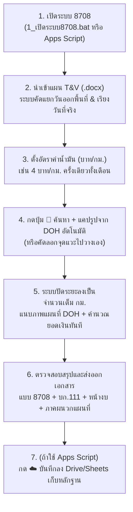

# คู่มือปฏิบัติงาน: การเบิกค่าน้ำมันเชื้อเพลิง แบบ 8708 + บก.111 ด้วยระบบอัตโนมัติ (อ.สีดา)

เอกสารนี้ออกแบบสำหรับเจ้าหน้าที่ **สำนักงานเกษตรอำเภอสีดา จังหวัดนครราชสีมา** เพื่อใช้ประกอบการจัดทำฎีกาเบิกค่าใช้จ่ายเดินทางไปราชการประจำเดือนตามแผน T&V System

---

## ผังขั้นตอนการทำงาน (End-to-End Workflow)

---

## ขั้นตอนการใช้งานรายเดือน

### ขั้นที่ 1: นำเข้าแผนการเดินทาง T&V (`.docx`)
1. เปิดระบบแล้วกดปุ่มสีเขียว **`📥 นำเข้าแผน T&V (.docx)`**
2. เลือกไฟล์แผนการดำเนินงานรายบุคคล เช่น `results_output_1_plan_dep.docx`
3. ระบบจะดึงข้อมูลอัตโนมัติ:
   - ชื่อผู้ขอเบิก, ตำแหน่ง, ประจำเดือน, ชื่อผู้บังคับบัญชา/ผู้รับรอง
   - เรียงลำดับวันที่ตามปฏิทินจริง (ป้องกันวันที่สลับจากเอกสารต้นฉบับ)
   - ติ๊กเลือก **วันออกพื้นที่ (VISITING)** ให้อัตโนมัติ และเว้น **วันประชุม ณ สนง. (DM/WM)** ไว้ (สามารถติ๊กปรับเพิ่ม/ลดได้)
4. กดยืนยันนำเข้า → ระบบจะพาไปยัง **ขั้นตอนที่ 5 (ตารางเดินทางรายวัน)** ทันที

### ขั้นที่ 2: ดึงระยะทางและแคปรูปจาก DOH TO TRAVEL
เลือกทำได้ **2 วิธี** (ใช้ร่วมกันได้ทุกวัน):

- **วิธีอัตโนมัติ (แนะนำ — ใช้คู่กับส่วนเสริม `DOH Auto-Bot`):**
  1. ตรวจให้ป้ายสถานะด้านบนขึ้น **`🟢 เชื่อมต่อ DOH Auto-Bot พร้อมดึงอัตโนมัติ`**
  2. กด **`🤖 ค้นหา + แคปรูปจาก DOH อัตโนมัติ (วันที่ยังขาด)`** (หรือกดปุ่ม `🤖 ดึง DOH อัตโนมัติ` เฉพาะวัน)
  3. บอทจะเปิดเว็บ `https://dohgis.doh.go.th/dohtotravel/` ค้นหาพิกัด `สำนักงานเกษตรอำเภอสีดา → หมู่บ้านตามแผน → สำนักงานเกษตรอำเภอสีดา` ด้วยเงื่อนไข **`ถนนหลัก (สั้นและตรง)`**
  4. ระบบสร้างภาพใบรายงานมาตรฐาน DOH (หัวเรื่องกรมทางหลวง + รายชื่อจุด + แผนที่เส้นม่วงพร้อมหมุด + ลายน้ำ + ระยะทาง/เวลา) ส่งกลับมาใส่ตารางให้อัตโนมัติ พร้อมปัดเศษลง (เช่น `42.66 → 42 กม.`) และคำนวณเงินทันที

- **วิธีทำด้วยตนเอง (กรณีไม่ใช้ส่วนเสริมหรือปรับแก้เฉพาะวัน):**
  1. กด **`📋 คัดลอกทุกจุด (1-คลิก)`** หรือกดคัดลอกทีละจุด (ใช้ปุ่ม `◀` / `▶` สลับลำดับหมู่บ้านได้)
  2. กด **`🔗 เปิดลิงก์เว็บ DOH TO TRAVEL ↗`** (`https://dohgis.doh.go.th/dohtotravel/`)
  3. พิมพ์ PDF มาอัปโหลดลงแถววันนั้น (ระบบอ่านระยะทางและครอปภาพให้อัตโนมัติ) **หรือ** แคปหน้าจอแล้วคลิกในแถววันนั้นกด **`Ctrl+V`**

### ขั้นที่ 3: ตรวจสอบยอดและพิมพ์ / ส่งออกเอกสาร
1. ตรวจแถบสถานะ **`หลักฐาน DOH (รูป+ระยะ)`** ให้ครบทุกวันที่เบิกน้ำมัน (เช่น `16 / 16 วัน`)
2. ตรวจสอบยอดรวมเบี้ยเลี้ยง, ค่าพาหนะ และเพดานงบประมาณรายเดือน (ถ้ามี)
3. กดสร้างเอกสารเพื่อตรวจดูหน้าจริงและส่งออกได้ทันที:
   - **พิมพ์เอกสาร (Print A4)**
   - **ดาวน์โหลด PDF** (รวมแบบ 8708 + บก.111 + หน้างบ + ภาคผนวกแผนที่ DOH รายวัน)
   - **ดาวน์โหลด Word (`.doc`)** สำหรับปรับแต่งข้อความเพิ่มเติม
   - *(กรณีใช้งานผ่าน Google Apps Script)* กด **`☁️ บันทึกลง Drive/Sheets`** เพื่อสำรองฉบับร่างและรูปภาพทุกวันขึ้น Google Drive

---

## การใช้งานสกิล (`.agent/skills/sida-8708-doh-fuel/`) สำหรับการพัฒนาต่อยอด
ภายในโฟลเดอร์มีไฟล์สกิลมาตรฐาน `.agent/skills/sida-8708-doh-fuel/SKILL.md` และเอกสารอ้างอิงใน `references/` หากต้องการให้ AI (เช่น Antigravity) ช่วยปรับแก้แบบฟอร์ม เพิ่มหมู่บ้าน เปลี่ยนอัตราน้ำมัน หรือแก้โค้ด Apps Script ในอนาคต สามารถเปิดโฟลเดอร์นี้เป็น Workspace แล้วสั่งงานได้ทันทีโดยไม่ต้องอธิบายกติกาใหม่ทั้งหมดครับ
